# Commission & Escrow Management — UML Class Diagram (As-Is)

> Khảo sát mã nguồn ngày 08/10/2026. Sơ đồ phản ánh **code đang chạy**, không giả định thêm Repository/DAO/IMapper/IHttpContextAccessor. Phạm vi chỉ gồm vòng đời Commission và escrow nội bộ; không gồm nạp ví/cổng thanh toán.

## 1. Phạm vi nghiệp vụ

- Tạo, nhận/từ chối/thương lượng commission; ký quỹ từ ví.
- Nộp WIP, watermark, yêu cầu sửa, duyệt milestone và giải ngân.
- Bàn giao file cuối, hoàn tất/hủy đơn, review và tranh chấp.
- Giữ tiền trong ví, giải ngân hoặc hoàn escrow theo trạng thái commission.

## 2. Bảng kế hoạch lớp và thành phần

| Tầng / stereotype | Thành phần thực tế | Vai trò |
|---|---|---|
| DTO `<<dto>>` | `CreateCommissionRequest`, `RespondCommissionRequest`, `RespondToCounterofferRequest`, `RequestRevisionRequest`, `CancelWithPolicyRequest`, `CreateDisputeRequest`, `CreateReviewRequest`, `CommissionDto`, `CommissionDetailDto`, `MilestoneDto`, `DisputeDto`, `ReviewDto` | Hợp đồng request/response của commission API. |
| Controller `<<controller>>` | `CommissionsController` | API commission/escrow; inject `ICommissionService`; lấy user id từ claims của `ControllerBase`. |
| Service contract `<<interface>>` | `ICommissionService`, `IWalletService` | Hợp đồng nghiệp vụ commission và các thao tác số dư phục vụ escrow. |
| Service `<<service>>` | `CommissionService` | State machine commission; transaction escrow; map entity→DTO bằng hàm private. Dependencies thực: `AppDbContext`, `IWalletService`, `IWatermarkService`, `IStorageService`, `IVoucherCheckService`, `INotificationPublisher`, `ILogger`. |
| Service `<<service>>` | `WalletService` | Giữ, giải ngân, hoàn tiền escrow và ghi biến động ví. |
| Persistence contract `<<interface>>` | `IApplicationDbContext` | Abstraction DbContext dùng bởi Application payment; expose `DbSet` và `Database`. |
| Persistence `<<dbcontext>>` | `AppDbContext` | EF Core Unit of Work/DAO thực tế; một DbContext duy nhất bảo đảm transaction xuyên Commission/Wallet/Ledger. |
| Repository/DAO | **Không có trong code** | Không tồn tại `ICommissionRepository`, `CommissionRepository`, `CommissionDAO`, `BaseRepository<T>`, `BaseDAO`. Không nên trình bày như lớp đã triển khai. |
| Entity `<<entity>>` | `Commission`, `Milestone`, `Dispute`, `Review` | Aggregate commission và các quan hệ 1–n/1–0..1. |
| Entity `<<entity>>` | `Wallet`, `WalletTransaction`, `CreatorProfile`, `ApplicationUser` | Ví, biến động tiền escrow, creator và user. |
| Base `<<abstract>>` | `BaseEntity` | `Guid Id`, `DateTimeOffset CreatedAt`, `DateTimeOffset? UpdatedAt`, `bool IsDeleted`; khác mẫu generic có `CreatedBy/UpdatedBy`. |
| Helper | `IWatermarkService`, `IStorageService`, `IVoucherCheckService`, `INotificationPublisher`, `ILogger<T>` | Watermark, storage, voucher, notification và logging. |

## 3. Mermaid.js Class Diagram

```mermaid
classDiagram
direction TB

class CreateCommissionRequest {
  <<dto>>
  +Guid CreatorId
  +Guid PackageId
  +string LicenseType
  +string Title
  +string? Description
  +DateTimeOffset? DeadlineAt
  +string? VoucherCode
}
class RespondCommissionRequest { <<dto>> +string Action +decimal? NegotiatePrice +string? RejectReason }
class RespondToCounterofferRequest { <<dto>> +bool Accept }
class RequestRevisionRequest { <<dto>> +string FeedbackComment +List~string~? ReferenceImages }
class CancelWithPolicyRequest { <<dto>> +string CancellationReason +string? Details }
class CreateDisputeRequest { <<dto>> +string Reason +List~string~? EvidenceUrls }
class CreateReviewRequest { <<dto>> +int Rating +string? Comment +List~string~? AttachedImageUrls }
class CommissionDto {
  <<dto>>
  +Guid Id
  +string Title
  +Guid ClientId
  +Guid CreatorId
  +decimal TotalPrice
  +decimal FinalPrice
  +decimal EscrowHeldAmount
  +decimal DisbursedAmount
  +string EscrowStatus
  +int CurrentStage
  +string Status
  +DateTimeOffset CreatedAt
}
class CommissionDetailDto { <<dto>> +List~MilestoneDto~ Milestones +ReviewDto? Review +DisputeDto? Dispute }
class MilestoneDto { <<dto>> +Guid Id +Guid CommissionId +int Sequence +string Title +decimal Price +string Status +int RevisionCount +int MaxRevisions +DateTimeOffset? SubmittedAt +DateTimeOffset? ApprovedAt }
class DisputeDto { <<dto>> +Guid Id +Guid CommissionId +Guid RaisedById +string Reason +string Status +decimal? ClientRefundAmount +decimal? ArtistPayAmount }
class ReviewDto { <<dto>> +Guid Id +Guid CommissionId +Guid ReviewerId +int Rating +string? Comment +string? ReviewerReply }
class CommissionsController {
  <<controller>>
  -ICommissionService _commissionService
  +CreateCommission(CreateCommissionRequest) IActionResult
  +GetCommissions(status,role,page,pageSize) IActionResult
  +GetCommissionById(Guid) IActionResult
  +RespondCommission(Guid,RespondCommissionRequest) IActionResult
  +DepositEscrow(Guid,string) IActionResult
  +SubmitMilestoneWip(Guid,Guid,IFormFile,string?) IActionResult
  +ApproveMilestone(Guid,Guid) IActionResult
  +RequestMilestoneRevision(Guid,Guid,RequestRevisionRequest) IActionResult
  +DeliverFinalWork(Guid,IFormFile) IActionResult
  +CompleteCommission(Guid) IActionResult
  +CancelCommission(Guid,CancelWithPolicyRequest) IActionResult
  +CreateDispute(Guid,CreateDisputeRequest) IActionResult
  +CreateReview(Guid,CreateReviewRequest) IActionResult
}
class ICommissionService { <<interface>> +CreateCommissionAsync(...) Task~CommissionDto~ +DepositEscrowAsync(...) Task~CommissionDto~ +SubmitMilestoneWipAsync(...) Task~MilestoneDto~ +ApproveMilestoneAsync(...) Task~MilestoneDto~ +CancelCommissionAsync(...) Task~CommissionDto~ +CreateDisputeAsync(...) Task~DisputeDto~ }
class CommissionService { <<service>> -AppDbContext _dbContext -IWalletService _walletService -IWatermarkService _watermarkService -IStorageService _storageService -IVoucherCheckService _voucherCheckService -INotificationPublisher? _notifications -ILogger~CommissionService~? _logger }
class IWalletService { <<interface>> +GetOrCreateWalletAsync(Guid) Task~Wallet~ +CreditAsync(...) Task~WalletTransaction~ +HoldFundsAsync(...) Task~WalletTransaction~ +ReleaseFundsAsync(...) Task~WalletTransaction~ +RefundHeldFundsAsync(...) Task~WalletTransaction~ }
class WalletService { <<service>> -IApplicationDbContext _db }
class IApplicationDbContext { <<interface>> +DbSet~Commission~ Commissions +DbSet~Milestone~ Milestones +DbSet~Dispute~ Disputes +DbSet~Wallet~ Wallets +DbSet~WalletTransaction~ WalletTransactions +SaveChangesAsync() }
class AppDbContext { <<dbcontext>> +DbSet~Commission~ Commissions +DbSet~Milestone~ Milestones +DbSet~Dispute~ Disputes +DbSet~Review~ Reviews +DbSet~Wallet~ Wallets +DbSet~WalletTransaction~ WalletTransactions }
class RepositoryDAO_Gap { <<not implemented>> ICommissionRepository / CommissionRepository / CommissionDAO / BaseRepository / BaseDAO }

class BaseEntity { <<abstract>> +Guid Id +DateTimeOffset CreatedAt +DateTimeOffset? UpdatedAt +bool IsDeleted }
class Commission { <<entity>> +string Title +Guid ClientId +Guid CreatorId +Guid? VoucherId +string LicenseType +decimal TotalPrice +decimal FinalPrice +decimal EscrowHeldAmount +decimal DisbursedAmount +EscrowStatus EscrowStatus +int CurrentStage +CommissionStatus Status +DateTimeOffset? DeadlineAt }
class Milestone { <<entity>> +Guid CommissionId +int Sequence +string Title +decimal Price +MilestoneStatus Status +string? OriginalWipUrl +string? WatermarkedUrl +string? FinalDeliverableUrl +int RevisionCount +int MaxRevisions }
class Dispute { <<entity>> +Guid CommissionId +Guid RaisedById +string Reason +string? EvidenceUrls +string Status +string? Resolution +decimal? ClientRefundAmount +decimal? ArtistPayAmount }
class Review { <<entity>> +Guid CommissionId +Guid ReviewerId +int Rating +string? Comment +string? ReviewerReply +bool IsVisible }
class Wallet { <<entity>> +Guid UserId +decimal Balance +decimal LockedBalance +string Currency +WalletStatus Status +byte[]? RowVersion }
class WalletTransaction { <<entity>> +Guid WalletId +WalletTransactionType Type +WalletTransactionDirection Direction +decimal Amount +decimal BalanceAfter +decimal LockedBalanceAfter +string? RefType +Guid? RefId }
class CreatorProfile { <<entity>> +Guid UserId +string DisplayName +bool IsAcceptingOrders +string? RateCardJson }
class ApplicationUser { <<entity>> +Guid Id +string FullName +bool IsVerified }

class IWatermarkService { <<interface>> +ApplyWatermarkAsync(Stream,string) Task~Stream~ }
class IStorageService { <<interface>> +UploadPublicAsync(...) +UploadPrivateAsync(...) +GeneratePresignedDownloadUrl(...) }
class IVoucherCheckService { <<interface>> +CheckAsync(...) }
class INotificationPublisher { <<interface>> +PublishAsync(...) }
class ILogger { <<logger>> }

CommissionsController ..> ICommissionService : <<uses>>
CommissionService ..|> ICommissionService : <<implements>>
WalletService ..|> IWalletService : <<implements>>
CommissionService --> "1" AppDbContext : injects
CommissionService --> "1" IWalletService : injects
CommissionService --> "1" IWatermarkService : injects
CommissionService --> "1" IStorageService : injects
CommissionService --> "1" IVoucherCheckService : injects
CommissionService --> "0..1" INotificationPublisher : injects
CommissionService --> "0..1" ILogger : injects
WalletService --> "1" IApplicationDbContext : injects
AppDbContext ..|> IApplicationDbContext : <<implements>>
IApplicationDbContext ..> RepositoryDAO_Gap : replaces in current design

Commission --|> BaseEntity
Milestone --|> BaseEntity
Dispute --|> BaseEntity
Review --|> BaseEntity
Wallet --|> BaseEntity
WalletTransaction --|> BaseEntity
CreatorProfile --|> BaseEntity
Commission "1" *-- "1..*" Milestone
Commission "1" *-- "0..1" Dispute
Commission "1" *-- "0..1" Review
CreatorProfile "1" <-- "0..*" Commission : creator
ApplicationUser "1" <-- "0..*" Commission : client
ApplicationUser "1" -- "0..1" Wallet
Wallet "1" *-- "0..*" WalletTransaction

CreateCommissionRequest "0..*" --> "1" CommissionsController : input
CommissionsController --> "0..*" CommissionDto : output
CommissionDetailDto --|> CommissionDto
CommissionDetailDto *-- MilestoneDto
CommissionDetailDto o-- DisputeDto
CommissionDetailDto o-- ReviewDto
```

## 4. Ghi chú sai khác với mẫu N-Layer

1. `AppDbContext` đang đóng vai trò EF Core DAO + Unit of Work; thêm Repository/DAO chỉ để “đủ tầng” sẽ nhân đôi abstraction và không phản ánh code.
2. `CommissionService` tự map bằng `MapToDto`; không inject `IMapper`.
3. Controller lấy identity từ `ControllerBase.User`; service nhận `Guid userId`, không inject `IHttpContextAccessor` — boundary này tốt hơn cho testability.
4. `BaseEntity` không generic, không có `CreatedBy/UpdatedBy`, và dùng `DateTimeOffset` thay vì `DateTime`.
5. Quan hệ Commission–Dispute và Commission–Review được DB enforce unique, nên multiplicity thực là `0..1` dù navigation property là collection.
6. Escrow commission được biểu diễn bởi `Commission.EscrowHeldAmount/EscrowStatus` và các `WalletTransaction` có `RefType/RefId`; không đưa luồng nạp ví/cổng thanh toán vào sơ đồ này.

## 5. Quy tắc an toàn tiền đã xác minh

- Mọi thao tác giữ, giải ngân hoặc hoàn escrow cập nhật `Balance/LockedBalance` và sinh `WalletTransaction` tương ứng.
- Deposit escrow và milestone release chạy trong transaction DB khi provider relational.
- `Commission.UpdatedAt`, `Status`, `EscrowStatus`, `CurrentStage`, `Milestone.Status` là concurrency token.
- Commission đã funded không được cancel trực tiếp; phải đi qua dispute.
